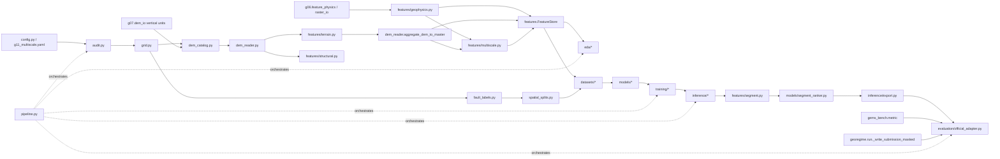

# G11 static audit (repository, 2026-11-10, HEAD c3fc34b)

This audit was made by reading the repository. The audit of the Drive artifacts is code (`gems_bench/g11/audit.py`, mode `AUDIT`) and runs in Colab; it has **not** been run.

## Findings that change the brief's assumptions

| brief assumption | repository fact | G11 handling |
|---|---|---|
| G06 physical indices MSDI, GSDI, TLI, CSCI exist | These names occur only inside base64 figure outputs of old notebooks. No code computes them. The G06 package (`gems_bench/g06/`) has a feature store with masked multiscale physics, structure, texture and context features. | G11 recomputes multiscale geophysics with the G06 masked operators (`g06.feature_physics.masked_smooth`). Existing G06 store rasters on the same grid are attached when a registry is found (`attach_g06_store`); otherwise they are recorded as ABSENT. |
| G07 "GeoFormer": T0 XGBoost, T1 SegFormer, T2 Swin U-Net, T4 gated transformer, `*_foldmasked_v2.npy` | `gems_bench/g07/` is the multiscale fault-discovery package (surface and subsurface models, DEM features, crossfit). No SegFormer, Swin or T4 code exists in the repository, and nothing writes `foldmasked` arrays. | The arrays are discovered on Drive by pattern. A `.npy` file is UNLOCATED (and excluded) unless a sidecar JSON or a same-shape GeoTIFF twin documents its CRS and transform; the shape alone never locates it. G11 includes its own SegFormer, and `load_compatible_weights` loads external weights only where key and shape match. |
| G08 DEM acquisition, G09.4 DEM EDA, G10 evidence registry | No `g08`, `g09` or `g10` code is in the repository. The DEM tooling that does exist is `gems_bench/dem/` and `gems_bench/g07/dem_*.py`. | Their outputs are discovered on Drive by pattern (optional, ABSENT if missing). G11 reuses the vertical-unit parsing in `g07.dem_io`. |
| "Official submission schema / columns / geometry"; "official evaluator" | The official format (DrivenData problem description, documented in `gems_bench/submission.py`) is a **single-band float32 GeoTIFF on the template grid with values in [0, 1]**. No official evaluator ships with the data. `gems_bench/metric.py` is the repository's re-implementation of DTI. | Candidate segments are rasterised into the template schema (`inference/export.py`), written with the existing V1 writer (`georegime.run._write_submission_masked`) and validated against the template. The official DTI is used only through `official_submission.evaluator_command`; the default status is `OFFICIAL EVALUATOR UNAVAILABLE`. The repository DTI is always labelled "offline proxy". |
| Fault vectors exist | The raw data in the repository's configs is a label **raster**, `existing_faults.tif`. | A vector layer is used if found. Otherwise segments are traced from the label-raster skeleton (`source='raster_skeleton'`) and no attributes are invented. |

## Dependency graph (code)

At runtime the audit writes the data-level dependency graph, with FOUND / ABSENT per source, to `00_audit/dependency_graph.md`.
