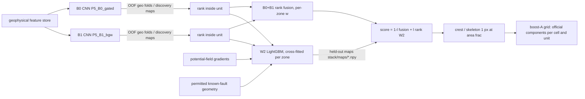
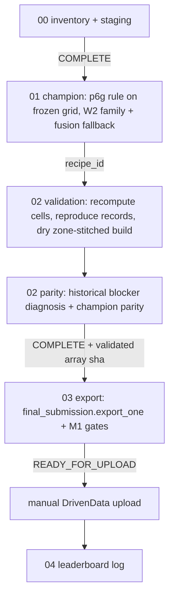
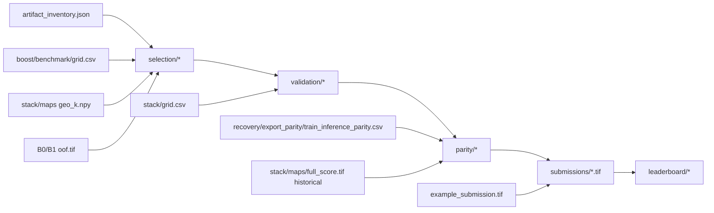
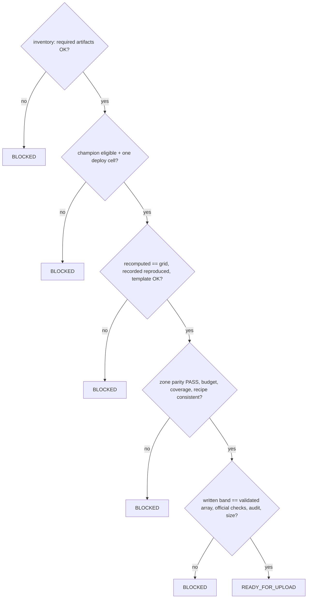

# M1 architecture

## B0 / B1 → W2 → candidate maps

## Champion recovery workflow

## Artifact dependencies

## Gates

## Code map (thin adapters; no P6 function is duplicated)

| module | role | reuses |
|---|---|---|
| `leaderboard_focus/config.py` | config, statuses | – |
| `artifacts.py` | inventory, staging, notebook-00 stage | `artifacts.sync.DriveSync`, `artifacts.atomic` |
| `session.py` | one-call attach, stage manifests, fingerprint reload | `Pipeline`, `P6FastTrack`, `p6.full_gpu` (mode recovery) |
| `champion.py` | candidate set, artifact gates, selection, recipe | `p6.full_benchmark.{load_grids, resolve_specs, protocol_check, benchmark_tables, meta_estimate}`, `export_parity.unit_overlap` |
| `validation.py` | recomputation, reproduction, dry build | `Boost.{fusion, stack_rank, cnn, _apply, _eval_q}`, `gems3.metric_opt.nested_select`, `final_submission.{inspect_spec, build_map}` |
| `parity.py` | blocker diagnosis | `export_parity.{agreement, classify_parity, read_band}`, `final_submission.zone_partition` |
| `submission.py` | export gate | `final_submission.export_one` (recipe, writer, `validate`, `readiness`) |
| `reporting.py` | reports, figures, leaderboard log | – |
