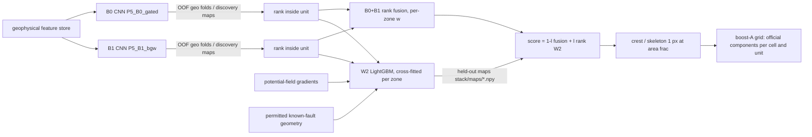
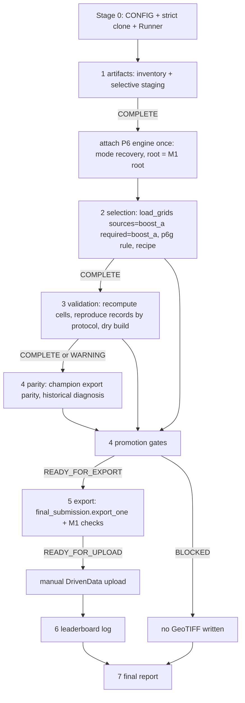
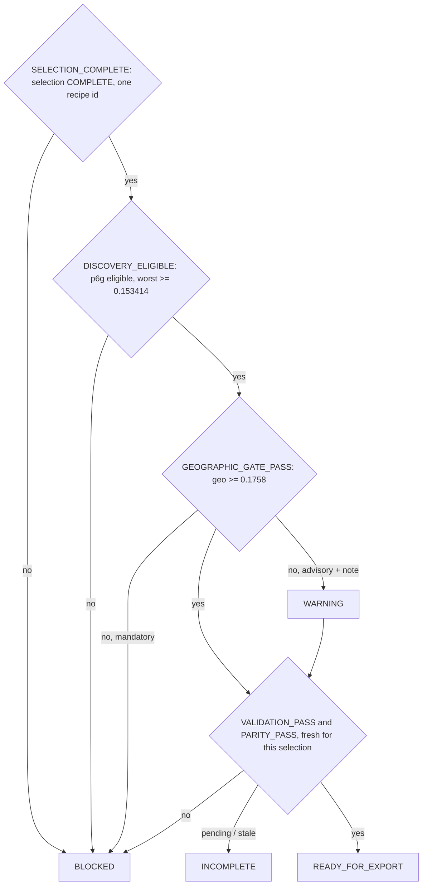
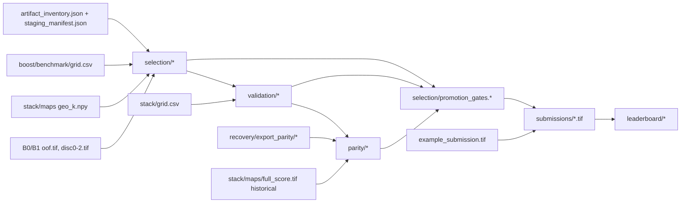

# M1 architecture

## B0 / B1 → W2 → candidate maps

## One notebook, one runner

Each stage function records `manifests/<stage>.json` (+ a copy in `manifests/history/`). A stage whose upstream is not
usable records INCOMPLETE and does no work; an exception is recorded FAILED with its traceback, the failure report is
written, and the exception is re-raised.

## Promotion gates

## Artifact dependencies

## Code map (thin adapters; no P6 function is duplicated)

| module | role | reuses |
|---|---|---|
| `p6/full_benchmark.py` | **shared** grid loader: `load_grids(fg, sources, required)`, `read_csv_checked`, `read_grid_csv`, `GridUnavailable`, `resolve_specs(fg, prov, candidates)` | – (P6 callers keep `load_grids(fg)`) |
| `leaderboard_focus/config.py` | config, status vocabulary, notebook CONFIG checks | – |
| `artifacts.py` | inventory, required-file checks, staging, stage 1 | `artifacts.sync.DriveSync`, `artifacts.atomic` |
| `session.py` | attach, targeted staging, stage manifests, implementation fingerprints, cache | `Pipeline`, `P6FastTrack`, `p6.full_gpu` (mode recovery) |
| `workflow.py` | `Runner`: modes, stage order, engine-once, failure report | every stage module |
| `champion.py` | candidate set, artifact gates, selection, recipe | `full_benchmark.{load_grids, resolve_specs, protocol_check, benchmark_tables, meta_estimate}` |
| `validation.py` | recomputation, protocol-labelled reproduction, dry build | `Boost.{fusion, stack_rank, cnn, _apply, _eval_q}`, `gems3.metric_opt.nested_select`, `final_submission.{inspect_spec, build_map}` |
| `parity.py` | export parity, historical blocker diagnosis | `export_parity.{agreement, classify_parity, read_band}`, `final_submission.zone_partition` |
| `gates.py` | promotion gates | – |
| `submission.py` | export precheck + gate | `final_submission.export_one` |
| `reporting.py` | reports, figures, leaderboard log, executive summary, failure catalogue | – |
